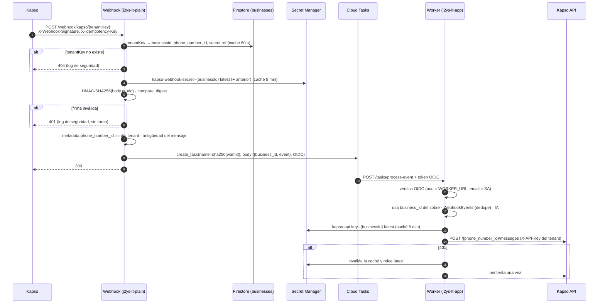

# Plan: Secret Manager, webhook por tenant y domicilios

Fase 0 (solo lectura). Rama `test/tesing_kapso`, HEAD `6547097`, 2026-10-14.
**No se ha tocado código.** Espera aprobación.

---

## 0. Lo que hay hoy (confirmado en el código)

| Tema | Dónde | Cómo funciona |
|---|---|---|
| Entrada del webhook | `app/services/webhook_entry.py` · `POST /webhook` | Un solo endpoint para Meta y Kapso. Valida la firma sobre el body crudo y después parsea el JSON. Separa los eventos (`split_events`) y encola cada uno. Responde 502 si falla el encolado. **No importa Firestore** (decisión de diseño, por el arranque en frío). |
| Firma | `app/services/whatsapp_client/signature.py` | Kapso: `X-Webhook-Signature`, HMAC-SHA256 en hex, sin prefijo. Meta: `X-Hub-Signature-256` con `sha256=`. Usa `hmac.compare_digest`. **Un solo secreto global** (`KAPSO_WEBHOOK_SECRET`) para todos los números. |
| Encolado | `app/services/tasks/cloud_tasks_client.py` | Nombre de tarea = `sha256(wamid)`: los duplicados se descartan con `AlreadyExists`. OIDC con `WORKER_SERVICE_ACCOUNT_EMAIL`. El body de la tarea es **el payload de Meta tal cual**, sin `business_id`. `enqueue_event` y `enqueue_flush` repiten el bloque OIDC/URL que ya está en `_create_named_task`. |
| Identificación del negocio | Worker · `webhook_event_router.route` → `find_business(display_phone_number, phone_number_id)` | Se deduce **del payload**, en el worker: primero por el número visible y después por `metadata.phone_number_id`. |
| Idempotencia en el worker | `WebhookEvents` (`register_event_once`) | Deduplica por wamid antes de procesar. |
| Envío | `WhatsAppClient.for_business` | Kapso: **una sola `KAPSO_API_KEY` global** (`X-API-Key`). Meta: token de `WhatsappCredentials` o el global `TEMP_TOKEN_WPP`. Caché de tokens de 5 min, sin invalidación por 401. |
| Worker | `app/services/worker_entry.py` | Cloud Run privado: IAM/OIDC. La cabecera `X-CloudTasks-QueueName` solo genera un warning. **El token OIDC no se verifica en la app.** |
| API admin (front) | `/api/v1/admin/*` en el worker, con `require_api_key` | `X-API-Key` comparada con `!=` (no es en tiempo constante). `POST /admin/businesses` crea `Businesses` + `Configurations`. |
| Roles | `app/ai/ai_restaurant/role_resolver.py` | `admin` si el número está en `Configurations.admin_phone_numbers`; si no, `cliente`. Los números se guardan **tal cual llegan de WhatsApp** (`573001234567`, sin `+`). |
| Esquema | `app/firestore_db/firebase_schemas.py` | `businesses` (identidad y número: `whatsapp_phone_number_id`, `whatsapp_provider`), `configurations` (lo que edita el front: admins, zonas, impresora, alertas, `delivery_confirmation_*`), `conversations` (`active_order_id`, `delivery_*`), `orders` (**una fila por ítem**; el pedido se identifica por el `order_id` del primer ítem), `order_status_history` (existe y **nadie la usa**), `webhook_events`, `whatsapp_credentials`. |
| Transacciones | — | **No hay ninguna** en el código. |
| Logs | `app/logging_setup.bind(...)` | Ya tiene campos estructurados (`business_id`, `wamid`...). |

### Secretos encontrados (para reportar)

- No hay `.env` versionado ni claves en el código (revisé `git ls-files` y busqué con `git grep`). `META_APP_ID` está en el código, pero es público.
- **Secret Manager está vacío** (auditoría del 2026-10-12, `README_KAPSO_HALLAZGOS.md` §1.4). `TEMP_TOKEN_WPP`, `APP_SECRET`, `VERIFY_TOKEN`, `API_KEY`, `KAPSO_API_KEY` y `KAPSO_WEBHOOK_SECRET` son variables de entorno en texto plano en Cloud Run: cualquiera con `run.services.get` las ve.
- **`whatsapp_credentials.access_token` está en texto plano en Firestore.**
- El esquema de `Configurations.printer_settings` prevé un `api_key` dentro del documento. Hoy no se usa (`PRINT_URL` es global), pero no debe usarse así.

### Kapso: qué está confirmado en la documentación oficial

Fuentes: [Security](https://docs.kapso.ai/docs/platform/webhooks/security.md) y [Overview](https://docs.kapso.ai/docs/platform/webhooks/overview.md).

| Pregunta | Respuesta | Estado |
|---|---|---|
| Header de la firma | `X-Webhook-Signature` | ✅ Confirmado |
| Algoritmo | HMAC-SHA256 | ✅ Confirmado |
| Bytes firmados | El body JSON **crudo** ("not a parsed object") | ✅ Confirmado |
| Formato | Hex sin prefijo `sha256=` (en los ejemplos y en el overview para `kind: meta`) | ✅ Confirmado |
| Alcance del secreto | `secret_key` **por webhook**. Hay un solo webhook Meta por número y el `secret_key` lo damos nosotros (Kapso no lo genera) | ✅ Confirmado: es **por tenant** |
| Header de idempotencia | `X-Idempotency-Key`, "opaque delivery identifier" | ✅ Confirmado |
| Timestamp firmado | **No existe.** No hay header de timestamp y la firma no incluye uno | ✅ Confirmado: no hay anti-replay por firma |
| Dónde viene el `phone_number_id` | Kapso no lo documenta. Como reenvía el payload de Meta tal cual, debería estar en `entry[].changes[].value.metadata.phone_number_id`, que es donde el código ya lo lee hoy y funciona en producción | ⚠️ Pendiente: confirmarlo con un evento real |
| Alcance de la API key | **Kapso no lo documenta.** El código y la auditoría asumen una sola key por proyecto. El prompt dice "cada cliente tiene su propio token de Kapso" | ❓ **Pregunta P1** |
| Reintentos | 3 intentos en ~50 s. Se debe responder 200 en ≤10 s. El webhook se pausa solo con ≥85 % de fallos | ✅ Ya documentado en `README_KAPSO_HALLAZGOS.md` |

---

## 1. Decisiones de diseño (con justificación)

### D1. Las referencias a los secretos van en `businesses`, no en `configurations`

- `businesses` ya guarda la **identidad del canal**: `whatsapp_phone_number_id`, `whatsapp_provider` y `waba_id`. El secreto pertenece a ese canal.
- El **webhook** tiene que resolver `tenantKey → negocio + phone_number_id + secreto de firma` con **una sola lectura**. Si la referencia estuviera en `configurations`, serían dos lecturas en el camino crítico.
- `configurations` es lo que el front edita libremente con el PATCH. Si la referencia estuviera ahí, un PATCH podría apuntar un negocio al secreto de otro. Las referencias solo se cambian por el endpoint dedicado.

Campos nuevos en `businesses`, todos opcionales para que los documentos viejos sigan sirviendo:

```
webhook_tenant_key: str                 # "test1_x8Kf..." (ver D3)
webhook_tenant_key_rotated_at: datetime
kapso_api_key_secret: str               # "projects/<p>/secrets/kapso-api-key--<businessId>"
kapso_webhook_secret_secret: str        # "projects/<p>/secrets/kapso-webhook-secret--<businessId>"
```

Se guarda el nombre del recurso **sin** `/versions/...`. El código siempre lee `latest`.

### D2. Convención de nombres de los secretos: la propuesta, **con el tipo primero**

`kapso-api-key--{businessId}` y `kapso-webhook-secret--{businessId}`.

Que el tipo vaya primero no es estética. Permite dar el mínimo privilegio con **una condición de IAM por prefijo**, sin tener que dar un permiso por cada secreto nuevo:

```
resource.name.startsWith("projects/<NUM>/secrets/kapso-webhook-secret--")
```

Si el negocio fuera primero (`{businessId}-...`), no se podría separar "el webhook solo lee firmas" con una sola regla. Los IDs de fireo son alfanuméricos y caben en el formato de Secret Manager (`[A-Za-z0-9_-]{1,255}`).

### D3. tenantKey

- Formato: `{slug[:12]}_{secrets.token_urlsafe(24)}`. Son 192 bits, más que los 128 pedidos. El slug sale del nombre del negocio, en minúsculas y solo con `[a-z0-9]`.
- Se guarda **en claro** en `businesses.webhook_tenant_key`. No va hasheado porque el front tiene que poder mostrar la URL en cualquier momento. La URL no es la barrera de seguridad: la barrera es la firma HMAC. La URL solo elige qué secreto usar y evita gastar lecturas en tráfico basura.
- Para buscarlo se usa `businesses.where(webhook_tenant_key == X)`, con el índice simple que Firestore crea solo.
- Caché en el webhook: un acierto se guarda 60 s y un fallo 30 s. La caché negativa evita que un escáner haga una lectura de Firestore por cada request. **Consecuencia:** al rotar la clave, la URL anterior puede seguir funcionando hasta 60 s en las instancias que ya la tenían en caché. Lo documento en lugar de agregar invalidación distribuida.

### D4. El webhook pasa a leer Firestore y Secret Manager

Esto cambia la decisión de "el webhook no importa Firestore". Se mantiene liviano así:

- Se usa `google.cloud.firestore` directo, que **ya está en las dependencias base**. No se usa fireo ni nada del worker.
- Se agrega `google-cloud-secret-manager`, que es la única dependencia nueva.
- Las dos lecturas quedan en caché, así que el costo solo se paga en el primer evento de cada tenant por instancia (~100–300 ms). Sigue lejos del límite de 10 s de Kapso.

### D5. Dónde va el estado de una incidencia: sin colecciones nuevas

- **Estado vivo:** un `MapField` `delivery_incident` en el `Orders` de referencia, que es el primer ítem y cuyo `order_id` ya es "el pedido" en todo el código. Se modifica **solo dentro de transacciones**.
- **Línea de tiempo:** en la colección `order_status_history`, **que ya existe y está sin uso**. Le agrego `customer_id`, `event_type` y `data` (map). Uso esa colección y no un array dentro del pedido por tres razones:
  1. Cada evento es una escritura nueva, así que no compite dentro de la transacción del estado.
  2. Sirve para buscar clientes reincidentes por `business_id + customer_id + event_type`, sin leer todos los pedidos.
  3. No crece sin límite dentro de un documento que se lee en cada turno.

  El volumen esperado es bajo: entre 5 y 15 eventos por incidencia.
- **Domiciliarios y reglas:** en `configurations`, como pide el prompt.

### D6. Números en E.164

Hoy los números se guardan sin `+` (`573001234567`) y `resolve_user_role` los compara con `in`. Si se reescribieran a `+57...`, los admins actuales dejarían de reconocerse.

Para no romper nada:
- Habrá un helper `normalize_phone()` que valida y convierte a E.164. Los campos **nuevos** (`couriers[].phone`) se guardan en E.164.
- La comparación de roles se hace **por dígitos** en ambos lados. Así `admin_phone_numbers` funciona en cualquier formato.
- `PUT /admin-phone-numbers` valida y normaliza desde ahora. Los datos viejos no se migran a la fuerza.

---

## 2. Parte 1: Secret Manager

### Archivos

| Archivo | Cambio |
|---|---|
| `app/services/secrets/__init__.py` (nuevo) | `get_secret(ref)` y `get_secret_versions(ref, n=2)`: cliente de Secret Manager con ADC, caché en memoria con TTL de 5 min, `invalidate(ref)` y `put_secret(secret_id, value)` (crea el secreto si no existe y agrega una versión). **Nunca** registra valores. Las excepciones se re-lanzan sin el payload. |
| `app/config.py` | Nuevo campo no sensible `SECRETS_CACHE_SECONDS=300`. Los campos sensibles siguen ahí **como fallback de la migración**, marcados como deprecated. |
| `app/firestore_db/firebase_schemas.py` | Los 4 campos de D1. |
| `app/services/whatsapp_client/whatsapp_client.py` | En `for_business` (Kapso), la key sale de `get_secret(business.kapso_api_key_secret)`. Si el negocio no tiene referencia, se usa `KAPSO_API_KEY` con **warning** `"Tenant sin secreto en Secret Manager; usando variable de entorno"` (con `business_id`). Con un 401 de Kapso se llama a `invalidate(ref)` y se reintenta una vez. |
| `app/api/v1/admin/businesses_router.py` | `PUT /admin/businesses/{id}/kapso-credentials` con body `{api_key?, webhook_secret?}`. Crea o actualiza los secretos, guarda **solo** las referencias y responde `{api_key_configured: bool, webhook_secret_configured: bool, updated_at}`. Nunca devuelve los valores. |
| `app/api/v1/deps.py` | Compara la API key con `hmac.compare_digest`. Es una línea. |
| `pyproject.toml` | `google-cloud-secret-manager` en las dependencias base, porque lo usan los dos servicios. |
| `cloudbuild.yaml` / README | Nada cambia en el build. Se documentan los comandos de IAM y cómo mover los secretos globales a `--set-secrets` de Cloud Run. |

### IAM con mínimo privilegio

| Cuenta de servicio | Rol | Alcance |
|---|---|---|
| Webhook (`j2ys-lt-plain`) | `roles/secretmanager.secretAccessor` | Proyecto, **condicionado** a `secrets/kapso-webhook-secret--*` |
| Worker (`j2ys-lt-app`) | `roles/secretmanager.secretAccessor` | Proyecto, condicionado a `secrets/kapso-api-key--*` |
| Worker (alta desde el front) | Rol custom `secretWriterTenant` (`secretmanager.secrets.create`, `secretmanager.secrets.get`, `secretmanager.versions.add`) | Proyecto, con la misma condición por prefijo (`kapso-api-key--` **o** `kapso-webhook-secret--`) |
| Webhook y worker | Secretos globales (`APP_SECRET`, `API_KEY`...) | `secretAccessor` **por secreto**, porque son pocos y fijos |

Doy el permiso por proyecto con condición, y no por secreto, porque si fuera por secreto el endpoint de alta necesitaría `secretmanager.secrets.setIamPolicy` (admin de Secret Manager) para darse acceso a cada secreto nuevo. Eso es más privilegio, no menos.

⚠️ **Riesgo R3:** hay que verificar en GCP que la condición por `resource.name` aplica a `secrets.create`, porque para esa acción el recurso todavía no existe. Si no aplica, el rol custom de escritura queda sin condición. Las mitigaciones son que el worker ya tiene acceso al resto, y que el endpoint solo construye nombres con esos prefijos.

### Fallback de migración

`negocio con referencia → Secret Manager` · `negocio sin referencia → variable de entorno + warning`. Cuando un `gcloud logging read` del warning salga vacío durante 7 días, se borran los campos sensibles de `config.py` y el fallback (es un commit aparte).

---

## 3. Parte 2: Webhook multi-tenant

### Archivos

| Archivo | Cambio |
|---|---|
| `app/services/webhook_entry.py` | Ruta nueva `POST /webhook/kapso/{tenant_key}`. **`POST /webhook` sigue igual** durante la migración (Meta directo y el secreto global de Kapso). |
| `app/services/tenants/resolver.py` (nuevo, liviano) | `resolve_tenant(tenant_key) -> Tenant(business_id, phone_number_id, webhook_secret_ref) \| None`, con Firestore directo y la caché de D3. |
| `app/services/whatsapp_client/signature.py` | Se reutiliza `verify_kapso_signature`. Se agrega la verificación contra varias versiones: `latest` y la anterior **habilitada**, para rotar el secreto sin cortar el servicio. |
| `app/services/messaging/webhook_payload.py` | `phone_number_ids(body)` y `message_timestamp(payload)`. |
| `app/services/tasks/cloud_tasks_client.py` | `enqueue_event(payload, wamid, business_id=None)`: el body pasa a ser `{"business_id": ..., "event": payload}`. Se elimina el bloque OIDC/URL duplicado en `enqueue_event` y `enqueue_flush`, que pasan a usar `_create_named_task`. |
| `app/services/worker_entry.py` | `/tasks/*` acepta **las dos formas** de body: las tareas viejas en vuelo traen el payload solo, y las nuevas traen el sobre. Verifica el token OIDC con `google.oauth2.id_token.verify_oauth2_token`: la audiencia debe ser `WORKER_URL` y el `email` debe ser `WORKER_SERVICE_ACCOUNT_EMAIL`. Se salta solo si `CLOUD_TASKS_EMULATOR_HOST` está definido. |
| `webhook_event_router.route` / `find_business` | Si viene `business_id`, lo usa directamente (y comprueba que el `phone_number_id` coincide). Si no viene, se comporta como hoy. |
| `app/api/v1/admin/businesses_router.py` | `create_business` genera el `webhook_tenant_key`. Nuevos `GET /{id}/webhook-url` → `{url, rotated_at}` y `POST /{id}/webhook-url/rotate` → `{url}`. |
| `app/config.py` | Nuevos campos no sensibles `WEBHOOK_PUBLIC_BASE_URL` y `WEBHOOK_MAX_EVENT_AGE_SECONDS=900`. |

### Orden de validación en `/webhook/kapso/{tenantKey}`

1. Se lee el body crudo.
2. `resolve_tenant`. Si no existe, se responde `404` con body vacío y se registra el log de seguridad `tenant_key_unknown` con el prefijo de la clave (no la clave completa) y la IP.
3. Se obtiene el secreto del tenant. Si el tenant no tiene secreto, se responde `503` con un error en el log (es un problema de configuración: Kapso reintenta).
4. Se verifica el HMAC contra `latest` y la versión anterior. Si falla, se responde `401`, se registra el log de seguridad `bad_signature` y **no se encola nada**.
5. Se parsea el JSON.
6. Si algún `metadata.phone_number_id` del body es distinto de `business.whatsapp_phone_number_id`, se responde `403` y se registra el log de seguridad `phone_number_id_mismatch`.
7. Por cada evento:
   - **Mensaje más viejo que `WEBHOOK_MAX_EVENT_AGE_SECONDS`** (según `messages[].timestamp`): se registra el log y se **descarta con 200**. No se responde con un error porque Kapso lo contaría como fallo y podría pausar el webhook. Los eventos `history` quedan exentos, porque por definición son viejos.
   - Se encola con `business_id`. La deduplicación sigue siendo por el nombre de tarea (wamid). `X-Idempotency-Key` solo se registra en el log para trazabilidad: Kapso dice que es un identificador **de la entrega** y el wamid ya identifica el evento.
8. Respuesta `200`, o `502` si falló el encolado, igual que hoy.

### Anti-replay: limitación que hay que conocer

Kapso **no firma un timestamp**. Alguien que capture un request válido puede reenviarlo. Las defensas son estas:
- La deduplicación por wamid: el nombre de la tarea más `WebhookEvents`.
- La antigüedad del mensaje, que viene dentro del body firmado.

Un replay del mismo evento no causa efecto. Lo único que no se puede bloquear es un replay de un evento de **status** (no traen wamid y hoy se descartan), así que tampoco tiene efecto.

### Diagrama de secuencia



---

## 4. Parte 3: Domicilios e incidencias

### Configuración (en `configurations`, editable desde el front)

Se reutiliza lo que ya hay: `admin_phone_numbers`, `delivery_confirmation_enabled`, `delivery_confirmation_interval_minutes` y `manager_notification_delay_minutes`. No se duplica nada.

Campos nuevos:

```jsonc
"couriers": [
  {"phone": "+573001112233", "name": "Carlos", "active": true,
   "added_at": "...", "added_by": "admin:+57300... | front"}
],
"delivery": {
  "enabled": false,
  "follow_up_delay_minutes": 3,
  "max_attempts": 2,
  "max_wait_minutes": 10,
  "arrival_template": "pedido_llego",        // plantilla UTILITY aprobada (fuera de las 24 h)
  "incident_rules": {
    "customer_not_answering": {"paid": "leave_at_reception_with_photo",
                                "cash_on_delivery": "escalate",
                                "on_timeout": "return_order"},
    "address_not_found":      {"paid": "ask_customer", "cash_on_delivery": "ask_customer",
                                "on_timeout": "escalate"},
    "no_change":              {"paid": "not_applicable", "cash_on_delivery": "ask_customer",
                                "on_timeout": "escalate"},
    "incomplete_order":       {"paid": "escalate", "cash_on_delivery": "escalate",
                                "on_timeout": "escalate"}
  }
}
```

Las acciones posibles son un enum cerrado: `ask_customer`, `leave_at_reception_with_photo`, `escalate`, `return_order` y `next_delivery`. El front elige entre ellas y la IA nunca inventa una regla. Si un negocio no tiene `incident_rules`, se usan estos valores por defecto.

Nuevo endpoint: `PUT /admin/configurations/{id}/couriers`, que valida y normaliza a E.164. El PATCH general también acepta `delivery` (validado con Pydantic).

### Roles

`resolve_user_role` devuelve `admin`, `domiciliario` o `cliente`, comparando por dígitos (D6). Si un número es admin y domiciliario a la vez, gana `admin`. El rol `domiciliario` usa un agente nuevo y pequeño (`app/ai/ai_restaurant/courier/`) con 3 tools:

- `report_arrival(order_ref)`
- `report_incident(order_ref, tipo, detalle, apto?)`
- `report_delivered(order_ref, foto?)`

Admin, 4 tools nuevas:

- `list_couriers`
- `add_courier(phone, name)` y `remove_courier(phone)`: las dos piden **confirmación** con el mismo patrón de las zonas (F7).
- `resolve_incident(order_ref, decision)`

`add_courier`, `remove_courier` y `list_couriers` **solo existen en el agente admin**: un cliente no las tiene. Si un cliente pide "agrega a este domiciliario", el prompt responde con una negativa amable. Además, `inbound_pipeline` registra el log `courier_admin_attempt` cuando un no-admin menciona domiciliarios con intención de gestionarlos, detectado con una regex simple. Así el permiso no depende del modelo.

### Máquina de estados (genérica por tipo)

```
reported ──(revisar datos)──► resolved_by_notes ─► closed
    │
    └──► contacting_customer ──(tarea +N min)──► waiting
             ▲                                   │
             └──── attempt < max_attempts ───────┤
                                                 ├─(el cliente responde)─► customer_replied ─► closed
                                                 └─(attempts = max | max_wait)─► apply_rule
apply_rule ─► leave_at_reception (pide foto) ─► closed
          ─► escalated (resumen al admin, handoff existente) ─► closed (resolve_incident)
          ─► returned / next_delivery ─► closed
```

- `app/services/delivery/incidents.py`: `open_incident`, `on_customer_reply`, `on_follow_up` y `close`. Cada transición es una **transacción de Firestore** (`@firestore.transactional` sobre el `Orders` de referencia) que lee el estado, comprueba que la transición sea válida y escribe. Después de la transacción se escribe el evento en `order_status_history`.
- **Revisar antes de molestar a nadie:** se compara el apto reportado con `delivery_address`, se buscan palabras clave en las notas ("portería", "timbre", "dejar") y se mira `payment_status`. Si las notas ya resuelven el caso, se responde al domiciliario de inmediato.
- **Contactar al cliente:** si `wrote_within_24h`, va texto libre. Si no, va `send_template(arrival_template)`. Si no hay plantilla configurada, se escala de una vez con un warning.
- **Seguimiento:** `cloud_tasks_client.enqueue_incident_follow_up(order_id, attempt, delay)` crea una tarea con nombre `incident-{orderId}-{attempt}` hacia `/tasks/incident-follow-up`. La cancelación se hace con `delete_task` (y se ignora si la tarea no existe). La tarea **también** es idempotente por sí sola: si el estado ya no es `waiting` con ese `attempt`, no hace nada. Así, aunque la cancelación falle, nada se rompe.
- **Respuesta del cliente:** en `_process_customer_message`, si la conversación tiene un `active_order_id` con una incidencia en `waiting` o `contacting_customer`, el texto se reenvía al domiciliario, la tarea se cancela y el mensaje sigue además al agente con el estado de la incidencia en su contexto.
- **Escalado:** se usa `HandoffService.notify_admins` con un resumen armado **por código**, no por la IA. Ejemplo: `Pedido #A1F3, Laura, apto 502. Espera desde 7:42, 2 mensajes sin respuesta, contra entrega. ¿Llamas tú o lo devolvemos?`.
- **Envíos:** todos pasan por `WhatsAppClient.for_business`, así que usan el secreto del tenant de la Parte 1.

### Archivos

`configuration_schemas.py`, `firebase_schemas.py` (`couriers`, `delivery`, `Orders.delivery_incident` y campos de `OrderStatusHistory`), `role_resolver.py`, `inbound_pipeline.py` (enrutar el rol y las respuestas a incidencias), `vertical_registry.py` / `agent_factory` (agente courier), `admin_tools.py` y su prompt, el prompt nuevo del courier, `services/delivery/incidents.py`, `cloud_tasks_client.py` y `worker_entry.py` (`/tasks/incident-follow-up`), y `configurations_router.py`.

---

## 5. Commits (pequeños, en este orden)

1. `secrets`: módulo, dependencia, tests de caché, TTL e invalidación (sin cambio de comportamiento).
2. `secrets`: `for_business` con referencia y fallback, más el reintento ante 401.
3. `secrets`: endpoint `kapso-credentials` y `compare_digest` en `require_api_key`.
4. `tasks`: limpieza de la duplicación OIDC y sobre `{business_id, event}`. El worker acepta las dos formas.
5. `webhook`: tenantKey (generación, rotación y endpoints).
6. `webhook`: ruta `/webhook/kapso/{tenantKey}` (firma por tenant, `phone_number_id`, antigüedad).
7. `worker`: verificación del OIDC y uso del `business_id` del sobre.
8. `delivery`: esquema, `normalize_phone` y roles.
9. `delivery`: tools de domiciliarios del admin y su prompt.
10. `delivery`: máquina de incidencias, tareas y endpoint.
11. `delivery`: agente courier y enrutamiento de las respuestas del cliente.
12. `docs`: `SECURITY.md` y la lista de endpoints y esquema para el front.

**Despliegue:** el worker se despliega antes que el webhook, como ya hace `cloudbuild.yaml`, porque así el worker entiende el sobre nuevo antes de que llegue. La URL nueva se activa número por número en Kapso: la vieja sigue funcionando hasta migrar el último.

## 6. Tests

- **Webhook:** firma válida e inválida; firma válida con la versión anterior del secreto; tenantKey inexistente (404 sin tarea); `phone_number_id` de otro tenant (403 sin tarea); evento duplicado (una sola tarea); mensaje viejo (200 sin tarea); rotación del tenantKey (la clave vieja da 404 después del TTL y la nueva da 200); `/webhook` legado sin cambios.
- **Secretos:** caché, TTL, `invalidate` por 401, fallback a la variable de entorno con warning, ningún valor en `caplog`, y el endpoint de alta nunca devuelve los valores.
- **Worker:** OIDC válido, de otra cuenta o ausente, y body viejo y nuevo.
- **Domicilios:** cancelación de la tarea cuando el cliente responde; tarea que llega después del cambio de estado (no hace nada); cada rama de la regla (pagado / contra entrega / timeout); notas que resuelven el caso; ventana de 24 h contra plantilla; un no-admin intenta `add_courier` (sin tool y con el log registrado); confirmación antes de agregar; normalización a E.164 y comparación por dígitos con admins viejos.

---

## 7. Riesgos

| # | Riesgo | Mitigación |
|---|---|---|
| R1 | El webhook gana dependencias y latencia en frío (Firestore y Secret Manager) | Caché, cliente directo y medición del p95 antes y después |
| R2 | Kapso pausa el webhook si ≥85 % de entregas fallan, por ejemplo durante una rotación mal hecha del secreto | Verificar contra `latest` y la versión anterior; antigüedad y duplicados responden 200 |
| R3 | La condición de IAM por prefijo podría no aplicar a `secrets.create` | Verificarlo en GCP antes del commit 3 |
| R4 | Tareas en vuelo con el body viejo | El worker acepta las dos formas |
| R5 | La URL rotada sigue viva hasta 60 s | Documentado; TTL corto |
| R6 | Comparación de teléfonos por dígitos: dos países con los mismos dígitos | Es improbable con código de país; E.164 en todo lo nuevo |
| R7 | `orders` es una fila por ítem: el estado de la incidencia vive solo en el primer ítem | Es la misma convención que ya usan `save_order` y el admin |
| R8 | Sin plantilla UTILITY aprobada, no se puede escribir al cliente fuera de las 24 h | Se escala directo y se advierte en el front |
| R9 | Borrar tareas requiere `cloudtasks.tasks.delete` (no lo trae `roles/cloudtasks.enqueuer`) | Darle `roles/cloudtasks.taskDeleter` al worker; las tareas también son idempotentes sin cancelarlas |

## 8. Respuestas (2026-10-14)

- **P1:** cada cliente tiene **su propia API key** de Kapso y su propio webhook. Se mantienen los dos secretos por tenant.
- **P2:** el front queda fuera de alcance por ahora. Los endpoints se hacen igual que los admin existentes.
- **P3:** el domiciliario identifica el pedido por **apartamento**, por **nombre del cliente** o por **número de pedido**. El número de pedido es `#` + los primeros 4 caracteres del `order_id` en mayúsculas, y **se imprime en la comanda** para que coincida con lo que dice el domiciliario. `report_*` busca entre los pedidos despachados de hoy del negocio por cualquiera de los tres datos. Si hay más de uno que coincide, le pregunta cuál.
- **P4:** pendiente (ver la explicación en el chat).

## 8b. Preguntas originales antes de implementar

- **P1.** ¿Cada cliente tiene **su propia API key de Kapso** (proyectos o clientes distintos en Kapso), o es una sola key de proyecto? El código usa una sola. Si es una sola, `kapso-api-key--{businessId}` sobra y se guarda **un** secreto `kapso-api-key` global. La firma sí es por tenant de todas formas.
- **P2.** ¿Cómo llama hoy el front a la API admin, si el worker es privado (IAM)? ¿Con una cuenta de servicio y un token de identidad, o con un proxy? Los endpoints nuevos se montan igual que los existentes.
- **P3.** ¿Cómo identifica el domiciliario el pedido? Hoy no hay número corto. Propongo mostrar `#` y los primeros 4 caracteres del `order_id` en mayúsculas en la comanda y en el aviso de despacho. Otra opción es un consecutivo diario, pero exige un contador con transacción.
- **P4.** ¿Te sirve un `WEBHOOK_MAX_EVENT_AGE_SECONDS` de 15 min? Los reintentos de Kapso duran unos 50 s, pero si Cloud Tasks se cae, prefiero no perder mensajes de un par de minutos.
